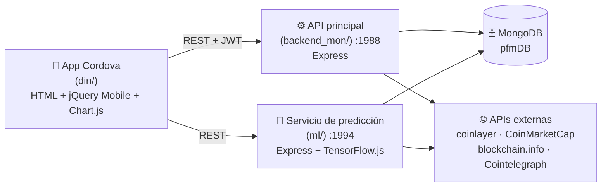

# CriptoVisor — Trabajo Fin de Máster

Aplicación móvil para el **seguimiento, análisis y predicción del mercado de criptomonedas**.
Reúne en un mismo producto lo que normalmente está disperso: los datos de mercado, la formación
para entenderlos y una estimación cuantitativa sobre la evolución del precio.

Desarrollado como TFM del Máster en Desarrollo Web (2020) y **modernizado en 2026**: se
externalizaron las credenciales, se reescribió la capa de autenticación, se migró el backend a
`async/await` con Mongoose 8 y se añadieron pruebas automatizadas. Ver [Seguridad](#seguridad).

---

## Funcionalidad

| | |
|---|---|
| 📊 **Cotizaciones** | Precios de BTC, ETH y divisas, con histórico y gráficas interactivas |
| 💼 **Cartera** | Registro de posiciones propias y valoración actualizada en euros |
| 🤖 **Estimador** | Predicción del precio de cierre con una red neuronal entrenada sobre el histórico de BTC |
| 📰 **Noticias** | Agregador vía RSS y boletín diario por correo a los usuarios suscritos |
| 📚 **Formación** | Sección de fundamentos y biblioteca para quien empieza |
| 🔐 **Cuentas** | Registro, login con JWT y recuperación de contraseña por token |

## Arquitectura



Son **dos servicios independientes** que comparten base de datos y secreto de firma de los
tokens. Aislar el entrenamiento en su propio proceso evita que una sesión de entrenamiento
—costosa en CPU— bloquee las peticiones normales de la aplicación.

Ambos servicios pueden ejecutar **tareas programadas** (`ENABLE_CRON=true`): actualización
nocturna de cotizaciones y noticias (01:30), reentrenamiento del modelo (02:30) y envío del
boletín diario (03:30).

## El modelo de predicción

El servicio `ml` entrena una red densa en TensorFlow.js sobre el histórico diario de BTC:

- **Entrada**: precio de apertura del día → **salida**: precio de cierre.
- **Topología**: 1 → 50 neuronas (sigmoide) → 1, optimizador Adam, error cuadrático medio,
  140 épocas con lotes de 45 muestras.
- Los datos se normalizan con *min-max scaling* antes de entrenar y se desnormalizan al predecir.
- El resultado se resume en los parámetros de una recta (`pendiente`, `nplus`) que se persisten
  en MongoDB, de forma que `/estimacion` responde sin recargar la red en cada petición.
- Se guarda además la nube de puntos (real frente a predicho) para dibujarla en el cliente.

## Puesta en marcha

**Requisitos**: Node.js ≥ 18 y MongoDB en local.

```bash
# 1. Base de datos
brew services start mongodb-community    # o: docker run -d -p 27017:27017 mongo:7

# 2. API principal
cd backend_mon
cp .env.example .env        # completa JWT_SECRET (openssl rand -hex 32)
npm ci && npm start         # http://localhost:1988

# 3. Servicio de predicción (en otra terminal)
cd ml
cp .env.example .env        # el MISMO JWT_SECRET que el anterior
npm ci && npm start         # http://localhost:1994

# 4. Frontend
cd din/www && python3 -m http.server 8080   # http://localhost:8080
```

Las direcciones de los servicios se declaran en un único sitio:
[`din/www/js/config.js`](din/www/js/config.js). Para desplegar, sólo hay que cambiar ese fichero.

Para compilar el APK, ver [`din/README.md`](din/README.md).

### Pruebas

```bash
cd backend_mon && npm test    # autenticación, autorización y humo
cd ml           && npm test
```

Usan una base de datos aparte (`criptovisor_test`) y no dependen de APIs externas.

## Endpoints principales

`backend_mon` (:1988) — 🔓 público · 🔑 usuario autenticado · 👑 administrador

| Método | Ruta | | Descripción |
|---|---|---|---|
| GET | `/health` | 🔓 | Estado del servicio |
| GET | `/registros` | 🔓 | Histórico de cotizaciones |
| POST | `/buscarPorFechaFiltrando` | 🔓 | Cotizaciones por rango de fechas y divisas |
| POST | `/convertirMonedas/:origen/:destino/:cantidad` | 🔓 | Conversión entre divisas |
| POST | `/convertirEuros/:origen/:cantidad` | 🔓 | Conversión a euros |
| GET | `/getMetricasGlobales` · `/getStats` · `/getLatestBlockData` | 🔓 | Métricas de mercado y de la cadena de bloques |
| POST | `/estimar` | 🔓 | Señal compra/venta sobre el histórico de BTC |
| POST | `/nuevoUsuario` · `/login` · `/forgot` · `/reset/:token` | 🔓 | Alta, acceso y recuperación de contraseña |
| GET | `/getLatestNews` | 🔓 | Últimas noticias |
| POST | `/getCartera` · `/addToCartera` | 🔑 | Cartera **del usuario del token** |
| GET | `/usuarios` · `/cartera` | 👑 | Listados completos |
| GET | `/updateDb` · `/updateNews` · `/createDailyNewsletter` | 👑 | Actualizaciones manuales |
| DELETE | `/borraTodosUsuarios` · `/borraTodosRegistros` · `/borraTodaCartera` · `/borrarTodasLasNoticias` | 👑 | Borrados masivos |

`ml` (:1994)

| Método | Ruta | | Descripción |
|---|---|---|---|
| GET | `/health` | 🔓 | Estado del servicio |
| POST | `/estimacion` | 🔓 | Precio de cierre estimado para un valor de apertura |
| GET | `/allData` · `/allNubePuntos` | 🔓 | Parámetros y nube de puntos del último entrenamiento |
| GET | `/entrenaModelo` · `/updateBTCJson` | 👑 | Reentrenar y refrescar el histórico |
| DELETE | `/borrarAllData` | 👑 | Borrado de entrenamientos |

## Seguridad

Revisión aplicada sobre el código original de 2020:

| Problema | Solución |
|---|---|
| Credenciales SMTP, API keys y secreto JWT escritos en el código | Todo en `.env` (ver `.env.example`); el servicio no arranca sin `JWT_SECRET` |
| Token JWT con payload `{check: true}`, sin identificar al usuario | El token lleva `username` y `permiso`, y se envía en `Authorization: Bearer` |
| Cualquier token válido operaba sobre la cartera de cualquier usuario | El propietario se toma del token, nunca del cuerpo de la petición |
| Borrados masivos y listado de usuarios abiertos a cualquiera | Middleware `requireAuth` / `requireAdmin` en todas las rutas sensibles |
| `/usuarios` devolvía los hashes de contraseña | Proyección que excluye `password` y los tokens de recuperación |
| El alta aceptaba el campo `permiso` del cliente (escalada de privilegios) | Se ignora: toda alta se crea con permiso 0 |
| Login registraba contraseñas, hashes y tokens en el log | Eliminados todos esos `console.log` |
| Mensajes distintos permitían enumerar usuarios | Respuesta 401 idéntica en todos los casos |
| Login reventaba con un usuario inexistente | Corregido y cubierto por un test de regresión |
| Token de recuperación con caducidad incoherente | Token aleatorio, guardado hasheado, válido una hora |
| Páginas privadas accesibles escribiendo la URL | Guarda de sesión en el cliente (`js/auth.js`) |
| `brain.js`, sin mantenimiento y con dependencias nativas vulnerables | Reescrito con TensorFlow.js; `npm audit` limpio |

**Limitaciones conocidas** (asumidas por tratarse de un proyecto académico): el tráfico entre la
app y los servicios va por HTTP, la whitelist de Cordova es abierta y no hay control de
frecuencia (*rate limiting*) en el login.

## Estructura

```
pfm/
├── backend_mon/     API principal: cotizaciones, usuarios, cartera y noticias
│   ├── api/{controllers,models,routes,middleware,services}
│   ├── data/        histórico de BTC usado por /estimar
│   └── test/        pruebas de autenticación, autorización y humo
├── ml/              Servicio de predicción (TensorFlow.js)
│   ├── api/{controllers,models,routes,middleware,services}
│   └── data/        cotizaciones históricas para el entrenamiento
└── din/             App híbrida Cordova (Android)
    └── www/         HTML, CSS y JS del cliente
```

## Tecnologías

Node.js · Express · MongoDB / Mongoose · TensorFlow.js · JWT · bcrypt · Apache Cordova ·
jQuery Mobile · Chart.js · Firebase · Nodemailer · node-cron
